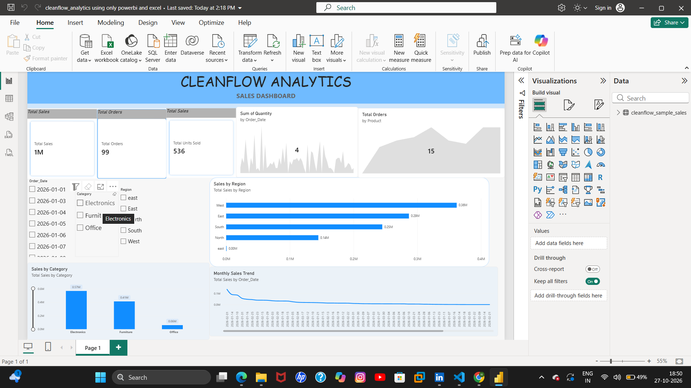

# cleanflow-analytics
Python-based data cleaning, data quality monitoring, automated reporting, and Power BI analytics dashboard.
# CleanFlow Analytics
### Intelligent Data Cleaning, Quality Monitoring & Business Intelligence Platform

CleanFlow Analytics is a data analytics project developed using **Python, Pandas, NumPy, and Microsoft Power BI**.

The project focuses on transforming raw sales data into clean, reliable datasets, identifying data quality issues, generating exception reports, and creating interactive business intelligence dashboards.

It demonstrates an end-to-end data analytics workflow, from raw data preprocessing to business insights and visualization.

---

## Project Objectives

- Clean and preprocess raw sales datasets.
- Identify missing values, duplicates, and invalid records.
- Standardize inconsistent data formats.
- Generate cleaned datasets for analysis.
- Create automated data quality exception reports.
- Build interactive Power BI dashboards.
- Analyze sales performance using key business metrics.
- Improve data reliability and support data-driven decision-making.

---

## Technologies Used

| Technology | Purpose |
|---|---|
| Python 3.12 | Data processing and automation |
| Pandas | Data cleaning and transformation |
| NumPy | Numerical data processing |
| Power BI | Interactive dashboards and visualization |
| Power Query | Data preparation |
| DAX | Business intelligence calculations |
| CSV | Dataset storage |
| Git & GitHub | Version control and project management |
| Visual Studio Code | Development environment |

---

## Project Structure

```text
cleanflow-analytics/
│
├── data/
│   ├── sample/
│   │   └── cleanflow_sample_sales.csv
│   │
│   └── cleaned/
│       └── cleaned_sales.csv
│
├── reports/
│   └── data_quality_exceptions.csv
│
├── src/
│   └── clean_data.py
│
├── CleanFlow_Analytics.pbix
├── cleanflow_analytics using only powerbi and excel.pbix
├── powerbi.png
├── powerbi and python.png
├── README.md
└── .gitignore
```

---

## Dataset Description

The project uses a sample sales dataset containing **100 records**.

### Dataset Columns

| Column | Description |
|---|---|
| Order_ID | Unique order identifier |
| Order_Date | Date of purchase |
| Customer | Customer name |
| Region | Sales region |
| Category | Product category |
| Product | Product name |
| Quantity | Number of units sold |
| Unit_Price | Price per unit |

The dataset contains intentional data quality issues to demonstrate the cleaning and validation process.

---

## Data Cleaning Process

The Python data cleaning script performs the following operations:

1. Loads the raw sales dataset.
2. Identifies and removes duplicate records.
3. Removes unnecessary whitespace.
4. Standardizes region and category names.
5. Converts date columns into appropriate formats.
6. Converts quantity and price fields into numeric values.
7. Identifies missing and invalid values.
8. Separates valid records from exception records.
9. Calculates sales revenue.
10. Exports cleaned data and exception reports.

### Data Quality Results

| Metric | Result |
|---|---:|
| Original Records | 100 |
| Duplicate Records Removed | 1 |
| Records After Deduplication | 99 |
| Valid Cleaned Records | 37 |
| Exception Records | 62 |

**Data quality summary:** After removing duplicates, 37 records passed validation, while 62 records were identified for further review.

---

## Power BI Dashboards

The project includes Power BI dashboards for visualizing sales performance and supporting business analysis.

### Dashboard 1: Sales Analytics

This dashboard focuses on sales performance using the original dataset.

**Key Visualizations:**
- Total Sales
- Total Orders
- Total Units Sold
- Sales by Category
- Sales by Region
- Sales Trends
- Interactive Filters and Slicers

### Dashboard 2: Cleaned Data Analytics

This dashboard focuses on business insights derived from Python-processed data.

**Key Features:**
- Analysis of cleaned sales records
- Sales revenue monitoring
- Data quality insights
- Regional and category-wise analysis
- Interactive visualizations

---

## Dashboard Screenshots

### Power BI Sales Dashboard



### Power BI and Python Analytics Dashboard


---

## How to Run the Project

### Step 1: Clone the Repository

```bash
git clone https://github.com/Haritha14-fab/cleanflow-analytics.git
```

### Step 2: Navigate to the Project Folder

```bash
cd cleanflow-analytics
```

### Step 3: Install Dependencies

```bash
python -m pip install pandas numpy
```

### Step 4: Run the Data Cleaning Script

```bash
python src/clean_data.py
```

### Step 5: Check Generated Outputs

After successful execution, the script generates:

```text
data/cleaned/cleaned_sales.csv
reports/data_quality_exceptions.csv
```

### Step 6: Open the Power BI Dashboard

Open the following file using Microsoft Power BI Desktop:

```text
CleanFlow_Analytics.pbix
```

If prompted, update the data source paths to match the downloaded project folder and refresh the dashboard.

---

## Key Features

**Automated Data Cleaning:** Processes raw sales data using Python.

**Data Validation:** Detects invalid, incomplete, and inconsistent records.

**Duplicate Detection:** Identifies and removes duplicate rows.

**Exception Reporting:** Stores invalid records separately for review.

**Sales Analytics:** Calculates sales revenue and supports business performance analysis.

**Interactive Dashboards:** Uses Power BI to visualize sales metrics.

**Reproducible Workflow:** Allows users to rerun the data cleaning process.

---

## Business Applications

CleanFlow Analytics can demonstrate data preparation and reporting workflows relevant to:

- Retail and e-commerce analytics
- Sales performance monitoring
- Business intelligence reporting
- Data quality assessment
- Operational analytics
- Data-driven decision-making

---

## Future Enhancements

- Integrate automated Excel reporting.
- Add advanced data quality scoring.
- Develop a Streamlit-based analytics interface.
- Support larger datasets and database connectivity.
- Implement scheduled data processing.
- Introduce automated data validation tests.
- Add predictive sales analytics.

---

## Project Outcomes

This project demonstrates practical experience in:

- Python programming
- Data cleaning and preprocessing
- Data quality monitoring
- Exploratory data analysis
- Power BI dashboard development
- Business intelligence
- Automated CSV reporting
- Git and GitHub

---

## Developed By

**Kommoju Haritha Alekya**

B.Tech — Computer Science and Engineering  
Adikavi Nannaya University College of Engineering

**GitHub:** [Haritha14-fab](https://github.com/Haritha14-fab)

**Project:** CleanFlow Analytics

---

⭐ If you find this project useful, consider starring the repository.